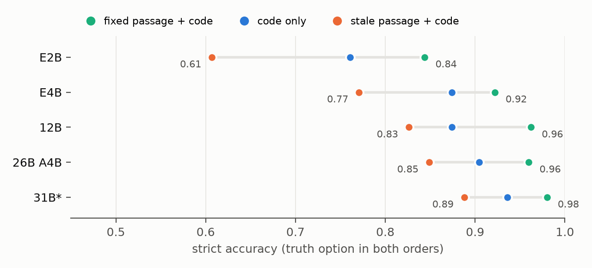
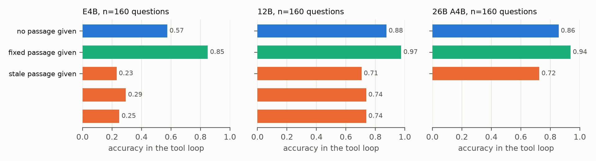

# Stale Docs Beat the Code: Real Documentation Fixes as a Paired Test for Local Gemma 4 Agents

**Subtitle:** DocLag, 443 contradictions that maintainers fixed in 185 open-source repositories, each paired with the passage they wrote to replace it

## Abstract

Coding agents read documentation before code, and documentation goes stale. We build DocLag from merged commits that changed documentation and no code: the maintainers replaced a false statement about their own code, so one source version comes with two passages, stale and fixed. From 643 popular repositories we keep 443 pairs in five languages (185 repositories, 397 test items), each with one question about the code's behaviour. A blind solver reading only the code agreed with 446 of 452 drafts, and 40 of 40 runtime probes confirmed the label. We ran Gemma 4 E2B, E4B, 12B, 26B A4B and 31B (Ollama, 4-bit) on free Kaggle T4s. Next to the code, the stale passage lowered strict accuracy by 23.7 points (E2B) to 9.2 points (31B) against the fixed passage, and left every model below its accuracy from code alone; a one-line rule that code wins recovered at most 7 points. In a tool loop over the real repositories, handing E4B the stale passage dropped it to 23% correct, against 85% with the fixed passage and 58% with no passage; 12B and 26B A4B lost 27 and 21 points, and making the agent read code before answering did not help. Asked directly, models flagged 0% to 44% of stale passages; comparing a model's answer from the passage with its answer from the code flagged 78% to 88% (exploratory, three models, 29% to 36% false alarms).

## 1. Introduction

For a small local model with few tool calls, documentation is a shortcut: one paragraph instead of a search. It fails when the paragraph is out of date. Earlier tests built such conflicts by hand: false comments on purpose-written tasks (Verifiable Is Not Valid, this track), drifted claims in synthetic projects (ClaimPatch-Bench, this track), or instruction files that ask for a different convention than the code uses [Xu & Wu 2026], whose authors note that their conflicts are cleaner than real ones.

We take the conflicts from history instead. When a maintainer merges a commit that edits only documentation, and the edit replaces a checkable claim about the code, the old claim was false about the code at that commit. Because no code changed, the commit gives a paired counterfactual for free: one code version, two passages, and the maintainers chose which passage is right.

Contributions:
1. **DocLag**: 443 real doc-versus-code contradictions with paired fixed passages, evidence spans, questions and free-form scoring patterns, and a mining pipeline that runs on any git repository.
2. **A paired measurement** of what one stale passage costs five Gemma 4 sizes with the code in the same prompt, with and without thinking, a precedence rule, longer code and free-form answers.
3. **A tool-loop test** in the real repositories at the parent and fix commits, plus two mitigations that do not fix the problem.
4. **A detection result**: asking whether a passage contradicts the code fails; comparing the answer from the passage with the answer from the code works much better.

## 2. DocLag

**Mining.** We took GitHub repositories with over 4,000 stars, pushed after June 2026, in Python, TypeScript, JavaScript, Go and Rust, under a licence GitHub reports as MIT, Apache-2.0, BSD, ISC, MPL-2.0, Unlicense or CC0, without lists and tutorials. For 643 repositories we read history since 2024 and kept non-merge commits touching at most four files, all documentation pages, or all source files with a subject naming docs or comments (no changelogs or translations). We kept hunks whose old and new text are similar (character ratio 0.45 to 0.995) and differ in a factual-looking token (number, code span, identifier, flag, *default*, *never*), minus typo, link and version edits. This gave 33,072 hunks. The final candidate pool was built from the 30,396 hunks available before the last five repositories finished; after subject and path rules, a cap of 14 hunks per repository and passage extraction, 4,256 candidates remained.

**Item writing.** Claude Haiku triaged candidates for "the old text states a checkable fact about the project's code and the new text replaces it" (1,105 kept of 2,401 seen). A script pre-searched the code at the parent commit, and Claude Opus 5.5 kept or rejected each candidate under a written specification, reading the code read-only. An item names an evidence span (at most 40 lines), a question containing neither answer, truth, stale and distractor options, and free-form scoring patterns. Of 908 decisions, 458 were kept; the main reasons to reject were "code does not settle it" (143), "fixed passage does not match the code either" (82), "not about code" (79) and "wording" (67).

**Checks.** A validator confirmed that the evidence file exists and is untouched by the commit. For Python docstring commits it required the module's AST to be identical after removing docstrings; for comment commits in other languages, the changed lines had to be comment lines. 6 drafts failed (4 on the AST check). Claude Sonnet answered each question from the code window alone, blind to passages and labels; it chose the truth for 446 of 452 items, and the other 6 were dropped. We installed 20 Python packages at the parent commits in a private Kaggle session and ran 40 behavioural probes; all 40 returned the truth option (two probes had import errors fixed after a failed run, logged). The building session read 30 random items against their evidence (30 consistent; 2 ask for a path the prompt header shows, 1 is a proxy question; a model check, not a human one). With at most 12 items per repository, DocLag has 443 items: 46 dev items (24 repositories) for prompt tuning and 397 test items (161 repositories). 347 fix commits date from February 2025 or later, after the Gemma 4 pre-training cutoff (January 2025).

**An item** holds repository, licence, parent and fix SHAs, the stale and fixed passages (edited lines plus their paragraph), a code window of the evidence span plus 30 lines each side (stale comments removed), a window of up to 200 lines each side, question, options, scoring patterns and category.

## 3. Experiments

**Models.** Gemma 4 E2B, E4B, 12B, 26B A4B and 31B, the Ollama `gemma4` tags (4-bit Q4_K_M), on two T4 GPUs in private Kaggle notebooks; temperature 0, seed 7, context 8,192 tokens. Thinking is off unless stated.

**Conditions.** The question comes with: nothing (Q); the stale passage (S); the fixed passage (F); the code window (C); stale passage then code (SC); fixed passage then code (FC); code then stale passage (CS); SC or FC with the line "If the documentation and the source code disagree, the source code is correct." (SCR, FCR). Four options: truth, stale, distractor and "the material given does not determine the answer". Each prompt runs in two option orders with truth and stale swapped; an item counts as correct only if both orders pick the truth (strict accuracy). Free-form answers are scored with the item's regular expressions.

**Detection and localisation.** Given passage and code, "does the passage contradict the code? YES or NO", for the stale and the fixed passage of each item; and "which numbered statement contradicts the code, or 0".

**Tool loop.** 160 test items, at most 3 per repository. The agent works in a checkout of the real repository (no `.git`) with `ls`, `grep`, `read` and `answer`, in JSON, for at most 10 turns. Arms: the repository at the parent commit with no passage in the prompt; the same with the stale passage in the first message; the fix-commit checkout with the fixed passage. Two arms were added after we saw the first results: a longer system instruction to verify in the code, and a harness gate that refuses an answer until a source file has been read.

**Statistics.** Items are the unit. Exact two-sided McNemar tests, Holm correction across the three planned comparisons per model, and 95% intervals from a cluster bootstrap over repositories (10,000 resamples). The analysis plan was frozen before any test call (our own timestamp, no third party); hashes of the plan, code and items are in the release. Confirmatory tests are H1 (FC above SC), H2 (SC below C), H3 (SCR above SC), H1f (H1 in free form) and H4 (tool loop, fixed above stale passage); everything else is exploratory.

## 4. Results

All numbers are on the 397 test items unless stated; 31B ran on a random 250-item subset.

**Table 1.** Strict accuracy, and paired differences in points with the items lost / gained and the exact McNemar p.

| Model | C | FC | SC | FC→SC | C→SC | SC→SCR | Free-form FC→SC |
|---|---|---|---|---|---|---|---|
| E2B | .761 | .844 | .607 | −23.7 (97/3), p<1e-24 | −15.4 (75/14) | +0.3 (12/13), p=1 | .833→.682 |
| E4B | .874 | .922 | .771 | −15.1 (64/4), p<1e-14 | −10.3 (51/10) | +3.5 (7/21), p=.013 | .856→.741 |
| 12B | .874 | .962 | .826 | −13.6 (56/2), p<1e-13 | −4.8 (35/16) | +7.1 (3/31), p<1e-6 | .903→.790 |
| 26B A4B | .904 | .960 | .849 | −11.1 (47/3), p<1e-10 | −5.5 (27/5) | +4.5 (6/24), p=.001 | .885→.787 |
| 31B* | .936 | .980 | .888 | −9.2 (24/1), p<1e-5 | −4.8 (16/4) | +6.0 (0/15), p<1e-4 | .915→.837 |

*250 items.

*Figure 1. Strict accuracy with the fixed passage, code only, and the stale passage, both beside the same code window.*

**A stale passage costs accuracy even with the code in view.** Replacing the fixed passage with the stale one, beside the same code, lowered strict accuracy in every model (H1 confirmed for all five, Holm-adjusted p below 1e-5). The cost shrinks with size but does not vanish: 23.7 points for E2B (95% cluster interval 18.9 to 28.7), 11.1 for 26B A4B (7.6 to 14.7) and 9.2 for 31B (5.3 to 13.3). It also lowered accuracy against code alone (H2 confirmed; E4B −10.3, interval 6.5 to 14.3), so the damage is not just a missing benefit. Free-form answers (the 390 items with both patterns; 246 for 31B) show a similar drop (H1f confirmed in all models), so the option format does not create the effect. Closed-book, E2B, E4B and 12B chose "cannot tell" for 81% to 94% of questions and got 2% to 6% right, so memorised project knowledge plays little part. For E4B the effect held before and after the Gemma 4 data cutoff (13 of 88 pre-cutoff items lost against 1 gained; 51 of 309 post-cutoff against 3), in all four main languages and for both documentation pages and code comments. Dropping the 30 items whose answer appears in the code path changes no conclusion (E4B −15.5 points).

**The passage overrides what the model can read (exploratory).** Among items E4B answered correctly from code alone, 14.7% were answered wrongly once the stale passage was added (E2B 24.8%, 12B 10.1%, 26B 7.5%, 31B 6.8%). Putting the code first (CS) made no significant difference for E2B, E4B or 12B. On a 200-item subset, a longer code window (up to 200 lines each side) raised the cost by 1 to 2 points over the short window on the same items (E2B 25.5 to 27.0, E4B 17.0 to 19.0, 12B 14.5 to 15.5).

**Thinking and the one-line rule.** Thinking (all items for E4B, the 200-item subset for E2B and 12B) raised accuracy from code alone to .925 to .960 but left gaps between FC and SC of 16.6 (E4B), 16.0 (E2B) and 20.5 points (12B). Stale passages made models write more: median output (thinking plus answer) for E4B was 467 tokens with SC against 370 with FC, for 12B 630 against 368; 12B hit the 3,072-token budget in 60 of 400 SC calls against 8 for FC, consistent with thinking not helping 12B on SC. The precedence rule of Xu and Wu, which moved frontier agents from 4% to 91% code-following, recovered 0.3 to 7.1 points here (H3 confirmed for E4B, 12B, 26B and 31B, not E2B), and cost E2B, E4B and 12B 2.0 to 2.3 points when the passage was right (FCR, exploratory).

*Figure 2. Tool-loop accuracy by arm, 160 questions per model.*

**In the tool loop, a stale passage in hand stops the search.** With no passage, E4B answered 57.5% of 160 questions correctly; given the stale passage it answered 23.1% and given the fixed passage 85.0% (101 items lost against 2 gained, p<1e-26; H4 confirmed). Episodes were short with a passage (4.1 turns against 7.8), and only 32.5% read the evidence file in either arm. When E4B read the evidence file in both arms (44 items, post-hoc subset), the stale arm was still 43 points worse (20 lost against 1 gained). Bigger models were hurt less but still clearly: 12B 70.6% against 97.5%, and 26B A4B 72.5% against 93.8%. In all three, the stale passage left the agent worse than no passage at all (E4B −34.4, 12B −16.9, 26B −13.1 points), and the fixed passage left it better (+27.5, +10.0, +8.1). Interpolating between the arms (exploratory), a passage helps this loop only while fewer than 44% (E4B), 37% (12B) or 38% (26B) of such claims are stale.

Two mitigations, added after we saw these results, did not close the gap for E4B. An instruction to verify in the code raised the stale arm from 23.1% to 29.4% (15 gained, 5 lost, p=.041). A gate that refused any answer until a source file had been read raised the share of episodes that read the evidence file from 32.5% to 54.4%, but accuracy only to 25.0% (p=.51); half of the gated stale episodes still chose the stale option, and the gate cost the fixed arm 11.3 points (p<.001). For 12B neither arm helped significantly (rule 70.6% to 73.8%, p=.46; gate to 73.8%, p=.27), although 79% of its stale-arm episodes already read the evidence file.

**Asking does not find the contradiction; comparing does.** Asked whether the passage contradicts the code, E2B said yes for 0.3% of stale passages, E4B 5.3%, 12B 39%, 26B A4B 34% and 31B 44% (false alarms on fixed passages 0% to 13%). Thinking lifted E4B to 64% at 20% false alarms. An exploratory detector with no new prompt does better: flag the passage when the answer from the passage alone differs from the answer from the code alone. For E2B, E4B and 12B it caught 78% to 88% of stale passages, at 29% to 36% false alarms on fixed ones, and flagged the stale and not the fixed passage for 51% to 61% of items, against 6% for a lexical baseline (added after the runs) that checks whether the passage's code spans appear in the code. Asked which numbered statement is wrong (395 items), 12B picked the edited one in 68% (random 24%), E4B 36% and E2B 15%.

**Reliability.** No call failed. 4 E2B and 80 12B answers (thinking runs at the budget) could not be parsed and count as wrong. Repeating 240 E4B calls gave the same choice 238 times; repeating 12B's four base tool-loop arms gave the same final choice in 92% to 99% of episodes.

## 5. Related work

Comment-code inconsistency is mostly studied as detection [Panthaplackel et al. 2021; Zhong et al. 2025a], including outdated README references [Tan et al. 2024] and README repair [Baek et al. 2026]. Macke and Doyle [2024] found that wrong comments hurt GPT-3.5 and GPT-4 on HumanEval more than missing ones. Xu and Wu [2026] showed that frontier agents follow stale instruction files over the code and that one precedence sentence fixes it; Gloaguen et al. [2026] found that context files rarely raise agent success. ImpossibleBench [Zhong et al. 2025b] sets tests against specifications. Knowledge-conflict work studies context against model memory [Longpre et al. 2021; Xie et al. 2023; Wu et al. 2024] and, for code, API evolution [Liu et al. 2024; Ashik et al. 2026]. In this track, the closest entries we could read use authored conflicts: false comments in 24 tasks with a null result on 4 discordant pairs (Verifiable Is Not Valid) and 192 synthetic doc-repair tasks without clean controls (ClaimPatch-Bench). Like SWE-bench [Jimenez et al. 2024] we mine merged changes, but documentation fixes, which give a paired control instead of a test.

## 6. Limitations

Items were written and filtered by Claude models; the blind solver and the probes check consistency with the code, and only 40 items have runtime confirmation. Selection keeps contradictions that one evidence span settles, so DocLag is easier than real search and the oracle code window is generous; the tool loop is the less generous test. The pool favours recently active, popular repositories, and its yield of Python docstring items is low. Licences are the repository-level licence that GitHub reports; some projects licence documentation separately. Models ran 4-bit through Ollama, not the official QAT checkpoints, and decoding was greedy. Temperature-0 batched decoding is not bit-reproducible; we report a retest. 26B and 31B ran a reduced set of conditions because of the free GPU budget.

## 7. Release and AI use

Code, items, raw model outputs for every call and the analysis scripts are in the repository, with the frozen plan and hashes. Item text comes from permissively licensed repositories, listed with commit SHAs in `ATTRIBUTION.tsv`. AI assistance: Claude models (Haiku, Sonnet, Opus 5.5) triaged candidates, wrote and audited items, wrote most of the code and drafted this text; every number in the paper is read from a results file produced by the released scripts.

## References

- Ashik et al. When LLMs Lag Behind: Knowledge Conflicts from Evolving APIs in Code Generation. arXiv:2604.09515, 2026.
- Baek, Krampf, Pradel. READU: Inconsistency-Driven Just-in-Time Detection and Repair of README Bugs. arXiv:2607.15780, 2026.
- Gloaguen et al. Evaluating AGENTS.md: Are Repository-Level Context Files Helpful for Coding Agents? arXiv:2602.11988, 2026.
- Google DeepMind. Gemma 4 model card. ai.google.dev/gemma/docs/core/model_card_4.
- Jimenez et al. SWE-bench: Can Language Models Resolve Real-World GitHub Issues? arXiv:2310.06770, 2024.
- Liu et al. CodeUpdateArena: Benchmarking Knowledge Editing on API Updates. arXiv:2407.06249, 2024.
- Longpre et al. Entity-Based Knowledge Conflicts in Question Answering. arXiv:2109.05052, 2021.
- Macke, Doyle. Testing the Effect of Code Documentation on Large Language Model Code Understanding. arXiv:2404.03114, 2024.
- Panthaplackel, Li, Gligoric, Mooney. Deep Just-In-Time Inconsistency Detection Between Comments and Source Code. arXiv:2010.01625, 2021.
- Tan, Wagner, Treude. Detecting Outdated Code Element References in Software Repository Documentation. arXiv:2212.01479, 2024.
- Wu, Wu, Zou. ClashEval: Quantifying the Tug-of-War between an LLM's Internal Prior and External Evidence. arXiv:2404.10198, 2024.
- Xie et al. Adaptive Chameleon or Stubborn Sloth: Revealing the Behavior of Large Language Models in Knowledge Conflicts. arXiv:2305.13300, 2023.
- Xu, Wu. Stale Instruction Files Override the Code in Coding Agents: A One-Sentence Fix. arXiv:2610.30571, 2026.
- Zhong et al. (2025a). CCISolver: End-to-End Detection and Repair of Method-Level Code-Comment Inconsistency. arXiv:2506.20558, 2025.
- Zhong, Raghunathan, Carlini (2025b). ImpossibleBench: Measuring LLMs' Propensity of Exploiting Test Cases. arXiv:2510.20270, 2025.
- Kaggle Gemma 4 Paper Track entries, public artefacts read 2026-11-07: Verifiable Is Not Valid (kaggle.com/datasets/gutchapagutchapa/verifiable-is-not-valid-release); ClaimPatch-Bench (github.com/RyanDev1st/claimpatch).
